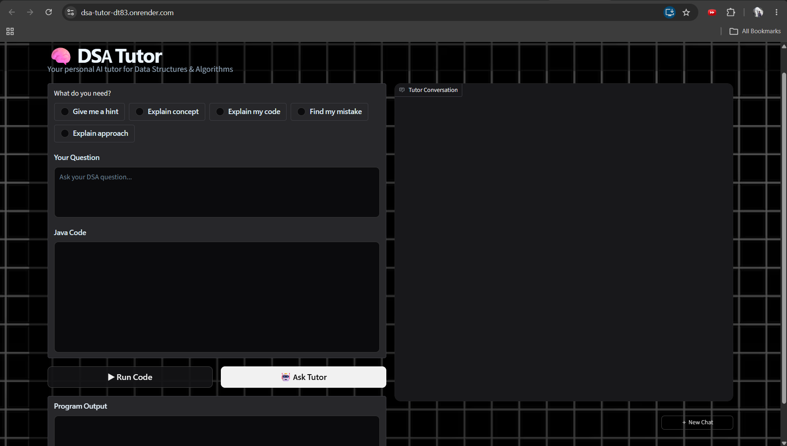
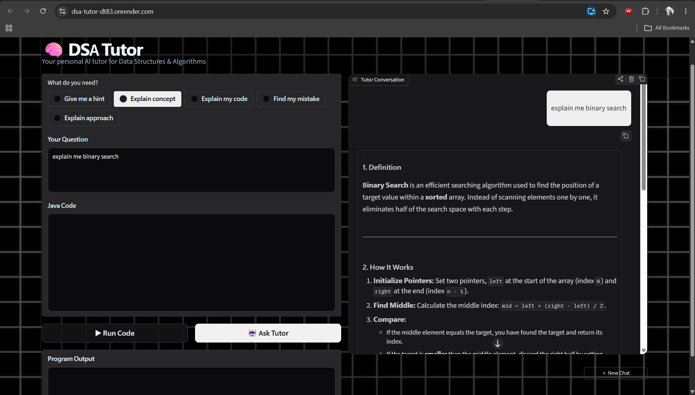
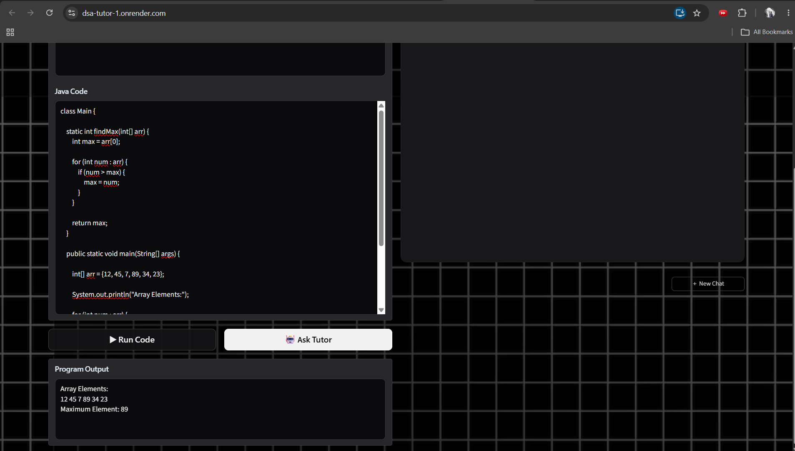
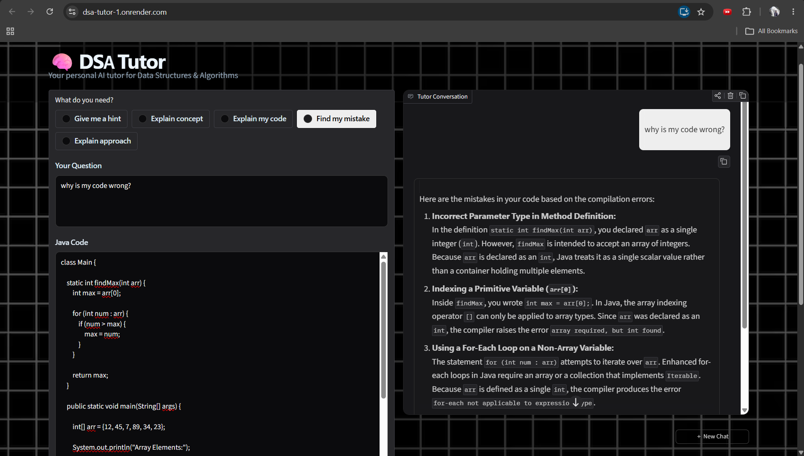

# DSA Tutor

An AI-powered DSA learning assistant that helps students understand data structures and algorithms, analyze their code, find mistakes, and execute Java programs.

## 🚀 Live Demo

[Try DSA Tutor](https://dsa-tutor-1.onrender.com)

## ✨ Features

* 🤖 AI-powered DSA tutoring
* 📚 RAG-based answers using a custom DSA knowledge base
* 💡 Concept explanations and hints
* 🔍 Code explanation and mistake detection
* 🧠 Approach explanation for DSA problems
* ☕ Java code compilation and execution
* 💬 Interactive chat with conversation history
* 🔄 New Chat functionality
* 📱 Responsive dark/grid interface

## 🧠 How It Works

DSA Tutor uses Retrieval-Augmented Generation (RAG) to provide context-aware answers.

```text
User Question
      ↓
Query Processing
      ↓
ChromaDB Vector Search
      ↓
Relevant DSA Knowledge
      ↓
Gemini LLM
      ↓
AI-generated Explanation
```

### Java Code Execution

```text
Java Code
    ↓
Docker Container
    ↓
javac Compilation
    ↓
Java Runtime
    ↓
Program Output
```

## 🛠️ Tech Stack

* Python
* Gradio
* LangChain
* ChromaDB
* Google Gemini
* Google Generative AI Embeddings
* Docker
* Java
* Git & GitHub

## 📚 Knowledge Base

The tutor currently contains knowledge covering:

* Arrays
* Linked Lists
* Stacks & Queues
* HashMaps
* Strings
* Binary Search
* Sorting
* Two Pointers
* Sliding Window
* Recursion
* Trees
* Binary Search Trees
* Heaps
* Graphs
* Greedy Algorithms
* Dynamic Programming
* Backtracking

## 🖥️ Screenshots

### Main Interface



### AI Concept Explanation



### Java Code Execution



### AI Code Error Analysis



## ⚙️ Run Locally

Clone the repository:

```bash
git clone https://github.com/SAMRUDH-A-V/dsa-tutor.git
cd dsa-tutor
```

Create a virtual environment:

```bash
python -m venv venv
```

Install dependencies:

```bash
pip install -r requirements.txt
```

Create a `.env` file and add your Google API key:

```env
GOOGLE_API_KEY=your_api_key
```

Run the application:

```bash
python ingest.py
python app.py
```

## 🐳 Docker

The project includes a Dockerfile that provides a consistent environment with Python and the Java JDK required for Java code compilation and execution.

## 🔮 Future Improvements

* Agent-based DSA problem solving
* LangGraph integration
* More programming language support
* Improved code analysis
* Personalized learning progress
* More advanced problem recommendations

## 👨‍💻 Author

**Samrudh A V**

Second-year Computer Science Engineering student interested in Software Development, AI, Generative AI and Agentic AI.
